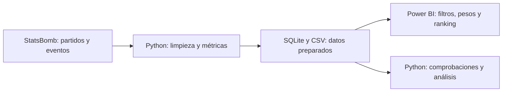

# Powerbi-scouting

Proyecto personal para practicar **Power BI, análisis de datos y Python**, con ayuda de IA durante el desarrollo. Uso el fútbol como caso práctico: comparar jugadores y ver cómo cambia el resultado cuando doy más importancia a unas cualidades que a otras.

**Proyecto cerrado · LaLiga 2015/16 · 21/10/2026.** El análisis histórico terminó el 17/10/2026 y se completa con la demo pública. Incluye preparación de datos, informe interactivo, revisión de resultados y documentación. Trabajar con temporadas actuales u otros proveedores queda como una posible ampliación.

[Explicación sencilla](docs/EXPLICACION.md) · [Ver el informe y las capturas](docs/evidencias/README.md) · [Reproducir el proyecto](docs/REPRODUCIR.md) · [Documentación completa](docs/README.md)


## Probar la demo sin instalar nada

[**Abrir la demo interactiva**](https://jjrn87.github.io/Powerbi-scouting/)

Elige un perfil, mueve los pesos, filtra por minutos y pulsa un jugador para ver qué aporta cada atributo. Los cambios solo afectan a tu sesión. Es una versión web del análisis; el informe de Power BI se conserva por separado. [Qué publica la demo y cómo se mantiene](docs/DEMO.md).

## Qué permite hacer

Elegir un perfil —central, lateral, pivote, organizador, mediapunta, extremo o delantero—, filtrar por equipo y ajustar la importancia de sus atributos. El informe ordena los candidatos según esas preferencias.

Por ejemplo, un centrocampista puede destacar por avanzar con el balón y otro por crear ocasiones de gol. Cambiar los pesos cambia lo que busco. El resultado es una lista para explorar; no determina por sí solo quién es el mejor futbolista ni cuánto costaría ficharlo.

La idea toma de Moneyball el uso de datos para cuestionar intuiciones. Este proyecto no incluye precios o salarios y, por tanto, no identifica fichajes infravalorados económicamente.

## Cómo funciona



Se comparan jugadores con al menos 900 minutos y un 50 % del tiempo en las posiciones admitidas por cada perfil. Las acciones se expresan por 90 minutos y se comparan con el grupo del perfil. Después se combinan mediante los pesos elegidos. Una puntuación alta indica buen encaje con esos criterios dentro de ese grupo.

## Qué he trabajado

| Área | Aplicación en el proyecto |
|---|---|
| Python | Descarga, reglas de limpieza, métricas y comprobaciones reproducibles. |
| Análisis de datos | Comparaciones por 90 minutos, percentiles, pesos y estabilidad del ranking. |
| Power BI | Importación con Power Query, relaciones entre tablas, medidas DAX y controles interactivos. |
| SQLite y CSV | Base local para consultar los datos y tablas de intercambio con Power BI. |
| IA | Apoyo en código, documentación y pruebas, dentro de un proceso de revisión. |
| GitHub, Jira y Confluence | Historial de cambios, seguimiento de tareas y documentación de decisiones. |

Mi parte ha sido definir el objetivo, pedir revisiones y cuestionar resultados como el de André Gomes por delante de Kroos y Trashorras. La IA ha ayudado con la implementación, las comprobaciones y la documentación. **El ranking se calcula con fórmulas explícitas; no hay un modelo de IA que elija jugadores ni un predictor entrenado en este proyecto.** El xG utilizado procede de StatsBomb.

## Qué muestran las comprobaciones

- **Power BI coincide con Python:** 1.359 comparaciones en seis escenarios, sin diferencias. Son cálculos comparados, no 1.359 jugadores distintos.
- **La demo conserva la base:** 387 puntuaciones y puestos comprobados al exportar, más pruebas de perfiles, pesos y filtros en la web publicada.
- **Los pesos importan:** André Gomes es tercero como organizador en la base y quinto al dar más importancia al pase progresivo y menos al regate.
- **Los minutos también importan:** Yoda y Burgui destacan con unos 975–979 minutos, pero sus puestos varían al cambiar la muestra de partidos.

La fuente incluye 380 partidos y 539 jugadores. Los siete perfiles producen 387 candidaturas de 311 jugadores distintos: una persona puede aparecer en varios perfiles. El cálculo se ha comprobado; su utilidad para predecir otra temporada no se ha evaluado. [Pruebas y resultados](docs/PROYECTO.md).

## Abrir o reproducir

Para probarlo sin instalar nada, abre la [demo web](https://jjrn87.github.io/Powerbi-scouting/). También están las [capturas de Power BI](docs/evidencias/README.md) y la [explicación](docs/EXPLICACION.md).

Para reconstruirlo hacen falta Python 3.10 o posterior, Internet para la descarga inicial y Power BI Desktop en Windows para abrir el informe. El proceso básico usa la biblioteca estándar de Python; el análisis adicional de estabilidad utiliza NumPy.

```powershell
python -m src.download
python -m src.build
python -m src.validate
python -m src.build_powerbi
```

Después se abre `powerbi/Powerbi-scouting/Powerbi-scouting.pbip` y se pulsa **Actualizar**. El generador ajusta la ruta de datos a la carpeta local. Al cambiar de perfil, se limpian las selecciones de pesos para recuperar su configuración base.

GitHub contiene el código y el proyecto Power BI, sin datos cargados. El PBIX local, los CSV completos y los eventos originales no se distribuyen. [Pasos completos y análisis opcionales](docs/REPRODUCIR.md).

## Posibles ampliaciones

Otra temporada, otro proveedor o métricas distintas permitirían repetir el enfoque. La versión actual está preparada y comprobada para StatsBomb LaLiga 2015/16: **cambiar la base de datos requiere adaptar la entrada, las definiciones y las pruebas**. No basta con sustituir un archivo.

La [propuesta de ampliación](docs/FUTURO.md) explica qué se puede reutilizar y qué habría que cambiar. Estas ideas quedan fuera de la versión finalizada.

## Fuente y organización

Datos: [StatsBomb Open Data](https://github.com/statsbomb/open-data), competición 11 y temporada 27, con versión fijada en `data/source-lock.json`. Análisis propio, sin afiliación al proveedor. [Atribución y condiciones de la fuente](docs/assets/ATRIBUCION.md).


[Jira](https://jjrn87.atlassian.net/jira/software/projects/SCOUT/boards/3) registra las tareas y [Confluence](https://jjrn87.atlassian.net/wiki/spaces/SCOUT/overview) las decisiones. La documentación y las capturas también están en GitHub, sin necesidad de acceso a Atlassian. La [forma de trabajo](docs/gestion/FORMA_DE_TRABAJO.md) describe las prácticas utilizadas.

El cierre reúne **once tareas terminadas y ninguna pendiente dentro de esta entrega**. La evaluación de datos actuales queda aplazada y fuera de alcance. GitHub y GitHub Pages son la presentación pública; Jira y Confluence requieren acceso al sitio. [Resumen del cierre](docs/PROYECTO.md) · [Registro de publicación](docs/evidencias/cierre-publicacion.json).
