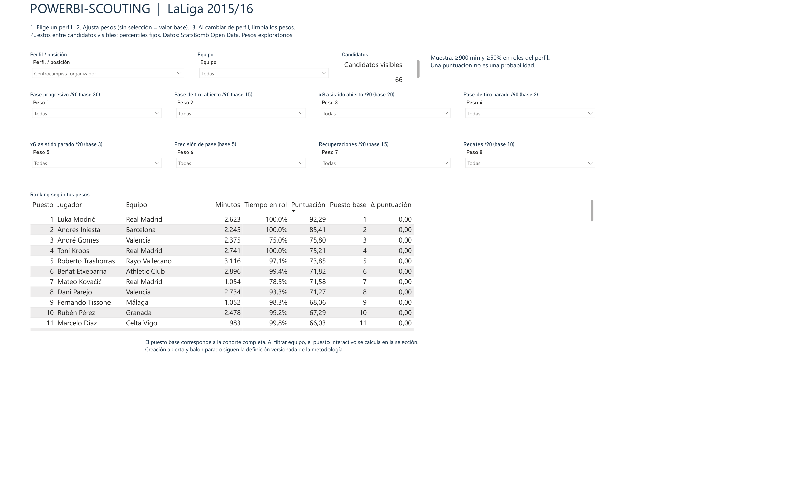

# Powerbi-scouting

Mi objetivo es usar datos de fútbol para localizar jugadores que encajen en lo que busco para una posición. La idea parte de Moneyball: elegir atributos, darles una importancia y ver qué candidatos aparecen arriba, pudiendo explicar por qué. Para empezar uso StatsBomb Open Data de LaLiga 2015/16, Python, SQLite y un informe interactivo en Power BI Desktop.

La pregunta es: **¿cómo cambia la selección de candidatos cuando cambia lo que buscamos en una posición?** Se comparan siete perfiles mediante percentiles y pesos editables. Un jugador puede encajar en varios perfiles; la puntuación no determina por sí sola su mejor posición ni garantiza rendimiento futuro.

**Documentación:** [índice](docs/README.md) · [capturas de Power BI, Jira y Confluence](docs/evidencias/README.md) · [revisión de pivote y delantero](docs/analisis/PIVOTE_Y_DELANTERO.md) · [forma de trabajo](docs/gestion/FORMA_DE_TRABAJO.md).

Datos: StatsBomb Open Data. Análisis propio, sin afiliación al proveedor.




## Desarrollo asistido por IA

El proyecto se ha desarrollado con asistencia de IA. Mi parte ha sido definir lo que quería buscar, pedir la separación de creación en juego abierto y a balón parado y cuestionar resultados como el de André Gomes por delante de Kroos y Trashorras. La IA ha ayudado con la implementación, la documentación y las comprobaciones. El código y las reglas quedan disponibles para poder entenderlos y reproducirlos.

El trabajo documenta las decisiones y sus límites. La revisión técnica automatizada no equivale a una auditoría manual de cada evento ni a una validación futbolística definitiva. La [explicación del modelo](docs/EXPLICACION.md) resume sus reglas, resultados y límites.

## Estado del proyecto

La parte técnica de Power BI está terminada y comprobada en Desktop. Las 1.359 comparaciones con Python, repartidas en seis escenarios, no muestran diferencias. El seguimiento queda en diez tareas terminadas y una pendiente: evaluar proveedores de datos actuales. La revisión descriptiva de los siete perfiles está cerrada. El [resumen de validación](docs/VALIDACION_POWERBI.md) explica las pruebas y sus límites.

La [revisión de pivote y delantero](docs/analisis/PIVOTE_Y_DELANTERO.md) añade 40.000 simulaciones, 108 puntuaciones base reconciliadas y 48 comprobaciones directas de métricas sin diferencias. La [revisión de central, lateral, mediapunta y extremo](docs/analisis/CENTRAL_LATERAL_MEDIAPUNTA_EXTREMO.md) suma otras 80.000 simulaciones, 213 puntuaciones base, 196 métricas y 70 comprobaciones de minutos sin diferencias. Mustafi y Neymar tienen lideratos sólidos en los intervalos documentados; Filipe–Marcelo y James–Isco dependen más de la función buscada. Se mantienen los pesos oficiales. Las [decisiones de los siete perfiles](docs/analisis/DECISIONES_PERFILES.md) recogen las bases conservadas y las alternativas.

| Componente | Estado |
|---|---|
| Ingesta, transformación y controles de datos | Implementados y comprobados localmente |
| Rankings y visor HTML interactivo | Implementados; siete perfiles revisados descriptivamente, bases conservadas |
| Tablas, Power Query y medidas DAX | Ejecutados en Desktop y comparados con Python |
| Informe ejecutado en Power BI Desktop | Proyecto PBIP interactivo; seis escenarios de regresión sin diferencias |
| Estabilidad por partidos y contexto | Analizada en Python; escenarios separados del ranking oficial |
| Validación predictiva y valoración económica | Fuera del alcance actual |

El proyecto cuenta con documentación en Confluence y seguimiento en Jira, ambos sujetos al acceso del sitio de Atlassian. La [metodología](docs/METODOLOGIA.md), el [resumen de proyecto](docs/PROYECTO.md), la [explicación del modelo](docs/EXPLICACION.md) y una [instantánea del backlog](docs/backlog.json) están disponibles públicamente en este repositorio.

Se usan prácticas de trabajo iterativo y criterios de aceptación; no se presenta como Scrum completo. La [forma de trabajo](docs/gestion/FORMA_DE_TRABAJO.md) distingue lo realizado de lo propuesto.

## Entorno

Base analítica local de StatsBomb Open Data para explorar perfiles de jugadores con pesos editables. Python 3.10+; el proceso de datos usa la biblioteca estándar. El análisis de estabilidad por partidos utiliza NumPy, declarado en `requirements-analysis.txt`.

## Empezar

Si acabas de clonar este repositorio, ejecuta primero los comandos de **Reproducir**: los datos y los informes generados no están incluidos en GitHub. Después:

1. Abrir `outputs/revisar_rankings.html` en un navegador. Elegir perfil, ajustar pesos y pulsar un jugador para ver el desglose. Funciona sin conexión.
2. Leer `outputs/VALIDACION.md` para ver los diez primeros de cada perfil y su sensibilidad a cambios de pesos.
3. Ejecutar `python -m src.build_powerbi`, abrir `powerbi/Powerbi-scouting/Powerbi-scouting.pbip` en Desktop y pulsar Actualizar. Ver `powerbi/LEEME.md`.

El informe nativo contiene selección de perfil y equipo, ocho pesos ajustables y una página de validación Python–DAX. Los datos, la caché del modelo y el PBIX local no se distribuyen en GitHub. El proyecto PBIP y su generador permiten reproducirlo.

## Reproducir

Desde esta carpeta, en PowerShell:

```powershell
python -m src.download
python -m src.build
python -m unittest discover -s tests -v
python -m src.validate
python -m src.analyze_organizer
python -m src.build_powerbi
python -m src.analyze_profiles
python -m src.verify_review_players
python -m src.analyze_profiles --group cuatro_perfiles
python -m src.verify_remaining_players
python -m pip install -r requirements-analysis.txt
python -m src.analyze_match_stability
python -m unittest discover -s tests -v
```

La primera descarga necesita Internet. Las siguientes reutilizan archivos en caché. La reconstrucción y las validaciones funcionan sin conexión. La descarga fija un commit del repositorio en `data/source-lock.json`; no cambia de versión en cada ejecución. La descarga completa ocupa varios cientos de MB antes de comprimir; se conserva comprimida localmente.

Para cambiar pesos de forma permanente: editar `config/profiles.json`, ejecutar `python -m src.build` y `python -m src.build_powerbi`, cerrar y reabrir el PBIP y actualizar Power BI. El generador reconstruye el diseño: guardar aparte los cambios visuales manuales que se quieran conservar. Los cambios del visor son temporales y no modifican el fichero de configuración. El mínimo de referencia inicial es 900 minutos y la fracción mínima de tiempo en los roles es 50%. Si se cambia esta configuración, se reconstruyen los percentiles y la cohorte.

## Archivos y resultados que se generan

| Ruta | Contenido |
|---|---|
| `data/raw/` | JSON originales comprimidos, licencia y manifiesto de procedencia con hashes SHA-256. |
| `data/processed/football.sqlite` | Base relacional local: jugadores, partidos, intervalos de posición, métricas, perfiles y rankings. |
| `data/processed/*.csv` | Tablas de intercambio UTF-8, separador coma y punto decimal. |
| `outputs/revisar_rankings.html` | Exploración interactiva local y desglose de puntuaciones. |
| `outputs/VALIDACION.md` | Ranking base y prueba de sensibilidad. |
| `outputs/audit.json` | Auditoría de cobertura y reconciliación de goles. |
| `powerbi/Fuente.pq` | Importador Power Query con tipos explícitos y lectura de nulos. |
| `powerbi/Medidas.dax` | Parámetros de peso, puntuación y ranking interactivos. |
| `powerbi/Powerbi-scouting/` | Informe PBIP/PBIR y modelo semántico con dos páginas. |
| `src/build_powerbi.py` | Generador del informe y de la referencia de regresión DAX. |
| `docs/METODOLOGIA.md` | Definiciones, decisiones estadísticas y límites. |

## Revisión de perfiles

Los siete perfiles tienen revisión de candidatos, atributos, sensibilidad y decisión registrada. Se conservan las bases y se ofrecen escenarios según la función buscada. La revisión incluye minutos, rol y contexto del equipo. Está medido el efecto de usar solo creación en juego abierto en mediapunta y extremo; incorporarlo al modelo oficial es una mejora propuesta, todavía sin implementar.

Los pesos son hipótesis de scouting, no coeficientes aprendidos ni garantías de rendimiento. La validación técnica y la sensibilidad están automatizadas; la revisión descriptiva no acredita calidad predictiva ni sustituye observación futbolística. No se incluyen salarios, precios ni valoraciones económicas.

## Estabilidad por partidos y contexto

El [análisis de estabilidad](docs/analisis/ESTABILIDAD_PARTIDOS_CONTEXTO.md) utiliza 2.000 muestras de partidos y otras 2.000 de jornadas, con candidatos y pesos fijos. Yoda mantiene el top 10 en el 77% de las muestras de partidos y Burgui en el 65,7%; sus rangos centrales del 95% son 2–22 y 3–27. Los puestos exactos son menos estables que ante cambios moderados de pesos.

El contexto se explora con la proporción de pases de cada equipo, sin confundirla con posesión medida en tiempo. Es un diagnóstico separado: los datos, los pesos oficiales y Power BI se conservan.

## Fuente y uso

Datos: [StatsBomb Open Data](https://github.com/statsbomb/open-data), competición 11, temporada 27. Consultar la copia exacta de `data/raw/LICENSE.pdf`. El proyecto está preparado para investigación. Los eventos, la base y las tablas completas quedan excluidos del control de versiones; se publican resúmenes de análisis y capturas con atribución al proveedor. Ver [atribución](docs/assets/ATRIBUCION.md) antes de reutilizar el contenido.

El motor de puntuación está separado del procesamiento de eventos. Incorporar otro proveedor requerirá un adaptador y comprobar equivalencias de métricas; no se deben mezclar automáticamente definiciones diferentes.


## Organizador actualizado (v2)

El organizador separa volumen y xG asistido en juego abierto y a balón parado, con ocho pesos editables. Consultar `outputs/ORGANIZADOR_V2.md` para comparar los 66 candidatos con el perfil original y con la simulación 40/5. Los otros perfiles se conservan. El informe nativo incorpora los ocho controles. Al cambiar de perfil hay que limpiar las selecciones de pesos para recuperar los valores base del nuevo perfil.
