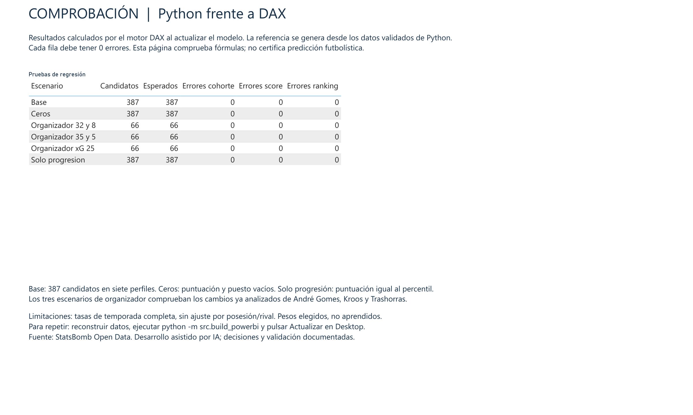
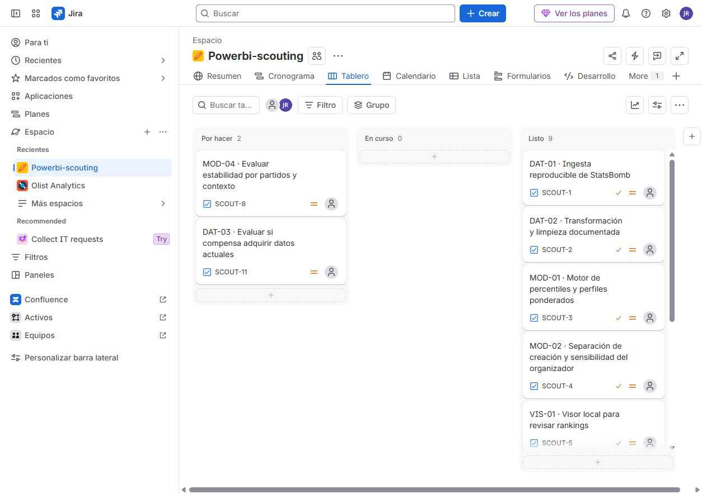
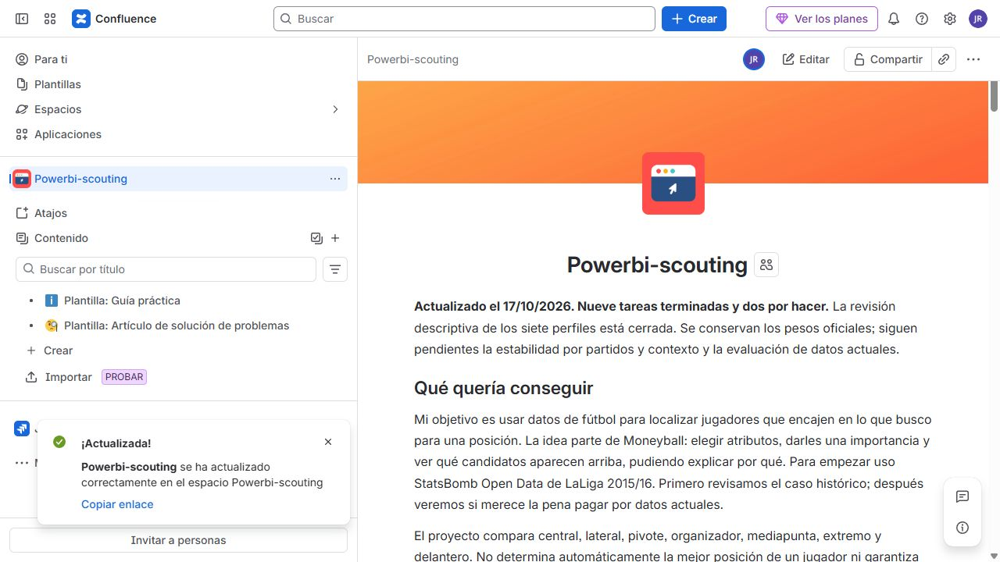

# Capturas y comprobaciones

Capturas reales del 17/10/2026. Muestran el informe y el uso de Jira y Confluence; no son maquetas. El código, las decisiones y los registros se enlazan para poder comprobar qué hay detrás.

## Power BI Desktop

Fuente de los análisis: [StatsBomb Open Data](https://github.com/statsbomb/open-data), LaLiga 2015/16. Análisis propio con asistencia de IA; sin afiliación ni respaldo de StatsBomb.

El informe permite seleccionar perfil, equipo y pesos. Esta captura corresponde al organizador y a la configuración base validada; los escenarios de las revisiones posteriores de los otros seis perfiles se han probado en Python.

La página de validación compara DAX con Python en seis escenarios: 1.359 comparaciones, cero diferencias. [Detalle de las pruebas](../VALIDACION_POWERBI.md).

## Jira

Tablero después de cerrar la revisión descriptiva de los siete perfiles: nueve tareas terminadas y dos por hacer. Siguen pendientes estabilidad por partidos/contexto y evaluación de datos actuales.

## Confluence

La página recoge el objetivo, la limpieza, la validación y los siguientes pasos. El contenido esencial también está en este repositorio para que se pueda leer sin una cuenta de Atlassian.

## Registros reproducibles

- [Validación de Desktop](powerbi-validacion.json): registro de la sesión, escenarios y hashes de los archivos probados.
- [Revisión de perfiles](revision-perfiles.json): método de sensibilidad, contraste base, recuento directo y límites.
- [Revisión de los cuatro perfiles restantes](revision-cuatro-perfiles.json): 80.000 simulaciones, 213 candidatos, 196 comprobaciones de métricas y 70 de minutos. Incluye la excepción Filipe–Marcelo que no apareció en el muestreo aleatorio.
- [Metodología](../METODOLOGIA.md) y [forma de trabajo](../gestion/FORMA_DE_TRABAJO.md).

Las capturas de herramientas documentan el proceso. No prueban por sí solas calidad predictiva ni aplicación de Scrum completo. No se publican los eventos originales, la base, los CSV completos, la caché ni el PBIX cargado. Las marcas pertenecen a sus titulares.
